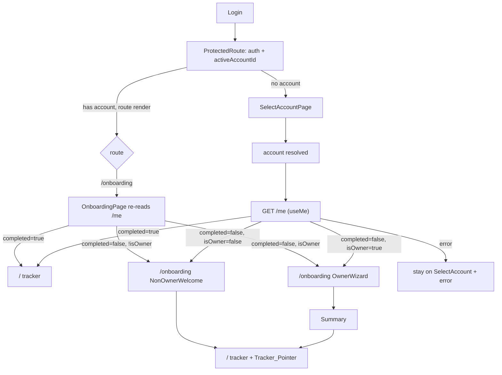
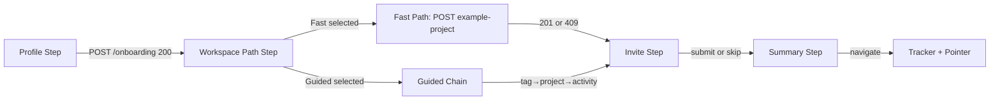

# Design Document

## Overview

The onboarding-experience feature gates first-run users after account resolution and drives them to the activation moment — their first timer start on a real activity — while teaching the MyTime model inline. It branches on `isOwner`: owners get a full multi-step wizard (`/onboarding`), invited non-owners get a lightweight welcome. Both branches finish by stamping `onboarding.completed`, so the flow never re-shows.

The feature is frontend-only. All persistence happens through four onboarding endpoints (`GET /me`, `POST /onboarding`, `POST /onboarding/light`, `POST /onboarding/example-project`) plus already-existing resource endpoints (tags, projects, activities, members, timer) reused unchanged. The design follows established project patterns: server state in TanStack Query, UI-only state in Zustand, forms via react-hook-form + Zod (`zod/v4`), the generated `openapi-fetch` client, and a full-screen no-chrome route mirroring `/select-account`.

### Key research findings (from codebase inspection)

- **`isAccountAgnosticPath` is the single injection point** for `X-Account-Id`. It currently excludes auth, `GET /accounts`, and `/palette`. `GET /me`, `POST /onboarding`, `POST /onboarding/light` must be added; `/onboarding/example-project` must NOT (it is account-scoped). This same predicate also gates the account-error redirect — so getting it right prevents `/me` failures from bouncing the user to `/select-account`.
- **The entry gate belongs in `SelectAccountPage`, not `ProtectedRoute`** (resolves OQ-3, justified below).
- **No stepper/wizard component exists.** `/select-account` is the full-screen no-chrome precedent; `invite-member-dialog.tsx` is the react-hook-form + Zod idiom to copy; the wizard needs a minimal step-index component.
- **Reusable hooks exist and are unchanged:** `useCreateTag`, `useCreateProject`, `useCreateActivity`, `useInviteMember`. New hooks (`useMe`, `useCompleteOnboarding`, `useCompleteLightOnboarding`, `useSeedExampleProject`) follow the same `client.GET/POST → throw error → invalidate` shape.
- **`/me` types are not in `src/api/schema.d.ts` yet** — `npm run api:generate` must run before implementation or `client.GET("/me")` is untyped (TS error). Confirmed the OpenAPI spec already defines `MeResponse`, `OnboardingRequest`, `LightOnboardingRequest`, `ExampleProjectResponse`.
- **Timer-start dismiss point:** the tracker starts timers via `useBlockClick(timerControls)` in `tracker.tsx`. The Tracker_Pointer dismiss hooks onto that click, not a new timer path.

## Architecture

### Entry gate placement (OQ-3 resolved)

**Decision: place the gate in `SelectAccountPage`, at the point where an account is resolved.** Rationale:

- The gate signal (`onboarding.completed`, `isOwner`) requires `GET /me`, which is only meaningful once an account is resolved. `SelectAccountPage` is already the sole place that resolves an account (both `autoSelect` and manual-pick branches converge there before `navigate(paths.tracker)`).
- `ProtectedRoute` runs on **every** app route render (tracker, entries, projects, reports…). Putting the gate there means firing `GET /me` and branching logic on every navigation — wasteful and easy to get into redirect loops. It also has no natural "just resolved an account" moment; it only knows auth + `activeAccountId` presence.
- `SelectAccountPage` already owns the "you just picked/were assigned an account, now go somewhere" transition. Redirecting to `/onboarding` vs `/` there is a one-line branch on data it must fetch anyway.

So the gate replaces the two `navigate(paths.tracker, ...)` calls in `SelectAccountPage` with a call into a shared `resolveEntryTarget(me)` helper that returns `/onboarding` or `/` (tracker). `/onboarding` itself remains a guarded route that re-checks `GET /me`, so a user who deep-links to `/onboarding` after completing is bounced to the tracker (and an incomplete user who deep-links to `/` is NOT force-redirected — the gate is an entry convenience, not a hard wall; completion is enforced by the once-only stamp, and the un-onboarded owner simply sees an empty tracker they can still populate. This keeps the gate simple and avoids global redirect loops).

### Route structure

A new guarded `/onboarding` route is added under `ProtectedRoute` but **outside** `<AppShell />`, mirroring `/select-account` (full-screen, no nav chrome — satisfies Req 2.7). `paths` gains `onboarding: "/onboarding"`.



### Owner wizard step machine



The step index is the single source of wizard position, held in a Zustand UI store (see State Management). `onboarding.completed` is stamped by the **Profile step** (`POST /onboarding`), per the locked completion semantics — everything after it (path, invites) is post-completion convenience within the same session and never re-prompts.

### Non-owner welcome

A single-screen form (displayName + timezone) plus 1–2 inline model-explainer cards, submitting `POST /onboarding/light`, then navigating to the tracker. No currency, no seeding, no invite, no Tracker_Pointer requirement beyond the shared hand-off (the non-owner lands on already-assigned activities).

## Components and Interfaces

All files kebab-case, components PascalCase, under `@/*`.

### API client change

`src/api/client.ts` — extend `isAccountAgnosticPath` so `/me` and the two non-scoped onboarding calls omit `X-Account-Id` and are skipped by the account-error interceptor. `/onboarding/example-project` stays account-scoped (it needs the header) and so does `/settings/avatar/upload` (out of scope here, but must not be broadened).

```ts
function isAccountAgnosticPath(pathname: string, method: string): boolean {
  if (isAuthPath(pathname)) return true
  if (/(^|\/)accounts$/.test(pathname) && method === "GET") return true
  if (/(^|\/)palette$/.test(pathname)) return true
  if (/(^|\/)me$/.test(pathname) && method === "GET") return true
  // /onboarding and /onboarding/light are account-agnostic;
  // /onboarding/example-project is NOT (must keep X-Account-Id).
  if (/(^|\/)onboarding$/.test(pathname) && method === "POST") return true
  if (/(^|\/)onboarding\/light$/.test(pathname) && method === "POST") return true
  return false
}
```

The `$`-anchored `onboarding$` pattern deliberately does not match `onboarding/example-project`, keeping that call scoped.

### Hooks (`src/hooks/`)

| Hook | File | Call | Notes |
|------|------|------|-------|
| `useMe` | `use-me.ts` | `GET /me` | `queryKey: queryKeys.me.all()`. The entry-gate + branch signal. |
| `useCompleteOnboarding` | `use-onboarding.ts` | `POST /onboarding` | On success: invalidate `me`, `account`, `profile`. |
| `useCompleteLightOnboarding` | `use-onboarding.ts` | `POST /onboarding/light` | On success: invalidate `me`, `profile`. |
| `useSeedExampleProject` | `use-onboarding.ts` | `POST /onboarding/example-project` | On success (201): invalidate `projects`, `tags`, `activities`. |

Reused unchanged: `useCreateTag`, `useCreateProject`, `useCreateActivity`, `useInviteMember`.

Cache-invalidation strategy: the gate re-reads `onboarding.completed` from the `me` query, so **every completion mutation invalidates `queryKeys.me.all()`**. This guarantees a subsequent `SelectAccountPage`/`OnboardingPage` read sees `completed = true` and routes to the tracker (Req 10.3). Seeding and guided-chain creations invalidate the resource lists so the tracker shows the new data on hand-off (Req 5.2, 6.7, 8.2).

New query keys added to `src/api/query-keys.ts`:

```ts
me: { all: () => ["me"] as const },
```

### Components (`src/components/onboarding/` + `src/pages/app/`)

| Component | File | Responsibility |
|-----------|------|----------------|
| `OnboardingPage` | `pages/app/onboarding.tsx` | Route entry. Reads `useMe`; guards (completed→tracker, error→message); branches owner→`OwnerWizard` / non-owner→`NonOwnerWelcome`. Full-screen, no shell. |
| `OwnerWizard` | `components/onboarding/owner-wizard.tsx` | Orchestrates step machine via the onboarding UI store; renders current step + `WizardStepper`. |
| `WizardStepper` | `components/onboarding/wizard-stepper.tsx` | Minimal step-index indicator (numbered dots + labels). Presentational; takes `steps: string[]`, `currentIndex`. |
| `ProfileStep` | `components/onboarding/profile-step.tsx` | displayName/timezone/currency form → `POST /onboarding`. |
| `WorkspacePathStep` | `components/onboarding/workspace-path-step.tsx` | Two selectable cards (Fast/Guided); requires one selection to advance. |
| `FastPathSeeder` | `components/onboarding/fast-path-seeder.tsx` | Fires `useSeedExampleProject`; handles 201/409/failure+retry. |
| `GuidedChain` | `components/onboarding/guided-chain.tsx` | Sub-step machine: tag→project→activity, each with inline concept copy. |
| `InviteStep` | `components/onboarding/invite-step.tsx` | Optional email list + skip; owner-only. |
| `SummaryStep` | `components/onboarding/summary-step.tsx` | Recap of created/seeded items + hand-off to tracker. |
| `NonOwnerWelcome` | `components/onboarding/non-owner-welcome.tsx` | displayName/timezone form + explainer cards → `POST /onboarding/light`. |
| `TrackerPointer` | `components/tracker/tracker-pointer.tsx` | One contextual hint at an activity card; dismisses on first timer start. |
| `InlineConcept` | `components/onboarding/inline-concept.tsx` | Small presentational card for step explainer copy (reused by chain + non-owner). |

### Tracker_Pointer integration

The pointer is shown when a "just onboarded" flag is set (onboarding store) and dismissed on the first timer start. Dismiss wires into the existing `useBlockClick` path in `tracker.tsx`: after a successful start, call `onboardingStore.dismissTrackerPointer()`. The pointer renders at the first activity card (Req 8.4 — exactly one pointer). This avoids adding a second timer-start code path.

## Data Models

### Generated API types (post `npm run api:generate`)

```ts
type MeResponse = components["schemas"]["MeResponse"]
// { user: MeUser; accounts: MeAccount[]; onboarding: MeOnboarding }
type MeUser = { id: string; email: string; displayName: string | null; timezone: string | null; avatar: string | null }
type MeAccount = { id: string; name: string; role: string; isOwner: boolean }
type MeOnboarding = { completed: boolean; completedAt?: string | null }

type OnboardingRequest = { displayName: string; timezone: string; currency: string; avatar?: string | null }
type OnboardingResponse = { message: string; accountId: string; currency: string }
type LightOnboardingRequest = { displayName: string; timezone: string; avatar?: string | null }
type LightOnboardingResponse = { message: string }
type ExampleProjectResponse = { message: string }
```

`avatar` is omitted from all onboarding request bodies (out of scope, Req 3.7).

### Form schemas (Zod `zod/v4`)

```ts
// profile-step.tsx
const profileSchema = z.object({
  displayName: z.string().trim().min(1, "Enter your name").max(100, "Name must be 100 characters or less"),
  timezone: z.string().trim().min(1, "Select a timezone").max(100),
  currency: z.enum(["USD", "EUR", "GBP", "PLN"]), // from SUPPORTED_CURRENCIES
})

// non-owner-welcome.tsx
const welcomeSchema = z.object({
  displayName: z.string().trim().min(1, "Enter your name").max(100),
  timezone: z.string().trim().min(1, "Select a timezone").max(100),
})

// guided-chain.tsx (per sub-step)
const tagSchema = z.object({ name: z.string().trim().min(1, "Enter a tag name") }) // color forced to "blue"
const projectSchema = z.object({ name: z.string().trim().min(1, "Enter a project name") })
const activitySchema = z.object({ name: z.string().trim().min(1, "Enter an activity name") }) // assignee forced to self

// invite-step.tsx — dynamic list, each entry validated as email
const inviteSchema = z.object({
  emails: z.array(z.string().trim().email("Enter a valid email address")).max(20),
})
```

Currency dropdown is populated from `SUPPORTED_CURRENCIES` (`src/lib/currency.ts`), rendered `symbol name`, value = 3-char code (never free text). Timezone default = `Intl.DateTimeFormat().resolvedOptions().timeZone`. displayName default = `me.user.displayName ?? ""`.

### Zustand onboarding UI store (`src/stores/onboarding-store.ts`)

UI-only state per project rules (server state stays in TanStack Query).

```ts
type WizardStep = "profile" | "path" | "guided" | "invite" | "summary"
type ChosenPath = "fast" | "guided" | null

interface OnboardingState {
  step: WizardStep
  chosenPath: ChosenPath
  seededExample: boolean          // Fast path succeeded this session — never re-offer (Req 5.5)
  createdSummary: { tag?: string; project?: string; activity?: string } // for Summary recap
  showTrackerPointer: boolean     // set on hand-off, cleared on first start (Req 8.4/8.6)
  goTo: (step: WizardStep) => void
  choosePath: (p: ChosenPath) => void
  markSeeded: () => void
  recordCreated: (partial: Partial<OnboardingState["createdSummary"]>) => void
  armTrackerPointer: () => void
  dismissTrackerPointer: () => void
  reset: () => void
}
```

`chosenPath` and `seededExample` are session-scoped (not persisted) — subsequent sign-ins re-read `onboarding.completed` from `/me` and skip the wizard entirely, so the un-chosen path and skipped invites never re-prompt (Req 10.4, 10.5).

## Correctness Properties

*A property is a characteristic or behavior that should hold true across all valid executions of a system — essentially, a formal statement about what the system should do. Properties serve as the bridge between human-readable specifications and machine-verifiable correctness guarantees.*

Most of this feature is UI rendering, routing configuration, CRUD-via-API wiring, and response-code-driven error branches — none of which are property-based-testable (they are covered by example, integration, and smoke tests in the Testing Strategy). Four areas are pure, input-varying logic and are extracted as testable pure functions/schemas so properties can hold over generated inputs.

### Property 1: Entry-gate decision is totally determined by (completed, isOwner)

For any `MeResponse`, the pure function `resolveEntryTarget(me)` maps the value to `"tracker"` when `onboarding.completed` is `true`; otherwise to `"wizard"` when the resolved account's `isOwner` is `true`, and to `"welcome"` when `isOwner` is `false`; and to `"stay"` when the onboarding status is absent or the input is malformed.

**Validates: Requirements 2.1, 2.2, 2.3, 2.4, 2.5, 10.3, 10.4, 10.5**

### Property 2: Required-field validation rejects any blank required field

For any input object and for each step schema (profile, guided tag, guided project, guided activity, non-owner welcome), if any required field is empty or whitespace-only, then schema validation fails (submission is blocked) and no create/completion request is produced; and if all required fields are non-blank and within bounds, validation succeeds.

**Validates: Requirements 3.8, 6.5, 9.7**

### Property 3: Invite submission fans out one invite per entry iff every entry is valid

For any list of email entries, submitting the Invite_Step sends exactly one invitation per entry (and advances) if and only if every entry is a syntactically valid email; otherwise submission is rejected, no invitation is sent, and every invalid entry is identified.

**Validates: Requirements 7.4, 7.6**

### Property 4: Summary recap includes every recorded item

For any recorded `createdSummary` (any subset of tag, project, activity names), the rendered Summary recap contains each present item name.

**Validates: Requirements 8.2**

## Error Handling

All API calls go through hooks that `throw error` on failure (matching existing hooks); components catch via `mutateAsync` try/catch and render an inline message using the `getErrorMessage(error)` idiom from `invite-member-dialog.tsx` (reads `err.type`, `err.detail`, `err.message`). No error toasts for expected flow branches.

| Condition | Handling | Requirement |
|-----------|----------|-------------|
| Any onboarding request fails | Inline error; `me` NOT invalidated to completed; values retained; retry possible. | 1.5, 10.6 |
| `GET /me` fails / no `completed` | `resolveEntryTarget` returns `"stay"`; stay on `SelectAccountPage` with "couldn't retrieve onboarding status" error; no routing. | 2.3 |
| `POST /onboarding` 400 (currency) | Stay on Profile_Step; message; retain all values. | 3.9 |
| `POST /onboarding` 404 (no owned account) | Stay on Profile_Step; error indication; retain values. | 3.10 |
| `POST /onboarding/example-project` 201 | Advance to Invite_Step; mark `seededExample`. | 5.2 |
| `POST /onboarding/example-project` 409 | Treat as already seeded; advance; **no error shown**. | 5.3 |
| example-project other status / >30s timeout | Stay on Fast_Path; "seeding failed" error; preserve retry. Timeout via `AbortController` at 30s. | 5.4 |
| Guided sub-step create fails | Stay on current sub-step; error; retain values. | 6.6 |
| Invite send fails | Stay on Invite_Step; error; retain entered values for retry. | 7.7 |
| Tracker navigation fails | Remain on Summary_Step; error + retry. | 8.5 |
| `POST /onboarding/light` fails | Stay on welcome; error; retain values; NOT complete. | 9.8 |

Validation errors (blank required fields) are surfaced by react-hook-form + zodResolver per field, blocking submit before any request fires (Req 3.8, 6.5, 9.7).

## State Management

Per project rules — server state in TanStack Query, UI-only state in Zustand, form state in react-hook-form.

- **Server state (TanStack Query):** `useMe`, and all create/complete/seed mutations. The gate and branch read exclusively from the `me` query; completion mutations invalidate `queryKeys.me.all()` so the next gate read reflects `completed = true`.
- **Wizard UI state (Zustand `onboarding-store.ts`):** current `step`, `chosenPath`, `seededExample`, `createdSummary`, `showTrackerPointer`. These are UI-only and session-scoped (not persisted) — subsequent sign-ins re-derive everything from `/me`. Follows the Zustand-in-effects rules: reactive reads via selectors (`useOnboardingStore((s) => s.step)`), imperative writes via `useOnboardingStore.getState().goTo(...)` in callbacks (never the whole store in a dependency array).
- **Form state (react-hook-form):** each step form owns its fields; `defaultValues` seed the pre-fills; `zodResolver` enforces the schemas.

### OQ-4 — un-chosen seeding path discoverability

**Recommendation: discoverable in-app via the tracker empty state, NOT in the wizard.** The wizard offers the seeding decision exactly once; after `onboarding.completed` is stamped, the wizard never returns. An owner who picked the Guided path (and so has no example project) can still surface an "Add example project" affordance from the tracker's empty/near-empty state, calling the same `useSeedExampleProject` (409-safe). This keeps the wizard single-pass while leaving the path recoverable. **Noted as a follow-up — it is out of scope for this spec** (the requirements only mandate that the wizard not re-prompt it, Req 10.5, which this design satisfies). Flagged here so it is not lost.

## Testing Strategy

### Dual approach

- **Property tests** (fast-check, ≥100 iterations each) for the four pure-logic properties above. fast-check is already the ecosystem-standard PBT library for TS/Vitest; do not hand-roll. Each test tagged `// Feature: onboarding-experience, Property N: <text>`.
- **Unit / example tests** (Vitest + React Testing Library) for UI presence, pre-fills, dropdown contents, transitions, selection gating, the Tracker_Pointer lifecycle, and the `isAccountAgnosticPath` predicate (including the `/onboarding/example-project` counterexample).
- **Integration tests** (mocked client) for response-code-driven branches: 400/404/409/timeout/generic failure, invite-send failure, navigation failure, and completion-stamping (mutation success invalidates `me` → refetch shows `completed`).
- **Playwright smoke** — the owner happy path: fresh account → Profile → pick a path → populated tracker → first timer start, asserting `onboarding.completed` afterward and no re-prompt on reload. Login for local runs: `alex@demo.test / password123`.

### Property test mapping

| Property | Pure unit under test | Generators |
|----------|----------------------|------------|
| P1 | `resolveEntryTarget(me)` | random `MeResponse`: `completed` bool/absent, `isOwner` bool, nullable displayName, 0..n accounts. |
| P2 | each Zod step schema `.safeParse` | random field objects incl. empty/whitespace/over-length. |
| P3 | invite submit handler with mocked `useInviteMember` | random lists of valid + invalid email strings, length 0..20. |
| P4 | Summary recap render | random `createdSummary` subsets of {tag, project, activity} names. |

### Explicitly NOT property-tested (and why)

- Route config, full-screen no-chrome rendering, field presence, dropdown contents → deterministic UI; example tests.
- `X-Account-Id` inclusion/omission → fixed path enumeration; example tests on the predicate.
- 400/404/409/timeout/failure branches, completion stamping → external-response-driven; integration tests with 1–3 representative cases (100 iterations add no bug-finding value and would hit mocked I/O).

## Requirements Traceability

| Requirement | Design elements |
|-------------|-----------------|
| 1. API client & type prerequisites | `isAccountAgnosticPath` extension; `npm run api:generate`; generated types in Data Models; hooks in `use-onboarding.ts`. |
| 2. Entry gate | `resolveEntryTarget` (Property 1); gate in `SelectAccountPage`; `/onboarding` route outside `AppShell`; `OnboardingPage` branch. |
| 3. Owner profile step | `ProfileStep` + `profileSchema`; `useCompleteOnboarding`; currency from `SUPPORTED_CURRENCIES`; timezone/displayName pre-fill; 400/404 handling. |
| 4. Workspace path decision | `WorkspacePathStep`; `chosenPath` store; selection gating. |
| 5. Fast path seeding | `FastPathSeeder`; `useSeedExampleProject`; 201/409/timeout handling; `seededExample` flag. |
| 6. Guided path chain | `GuidedChain` sub-step machine; reused `useCreateTag`/`useCreateProject`/`useCreateActivity`; blue token; auto-assign self; validation (Property 2). |
| 7. Optional invites | `InviteStep`; reused `useInviteMember`; skip/zero-entry handling; fan-out (Property 3); owner-only gating. |
| 8. Summary & hand-off | `SummaryStep`; `createdSummary` recap (Property 4); `TrackerPointer` armed on hand-off, dismissed via `useBlockClick`. |
| 9. Non-owner welcome | `NonOwnerWelcome` + `welcomeSchema`; `useCompleteLightOnboarding`; no currency/seeding; explainer cards. |
| 10. Completion semantics | `me` invalidation on completion mutations; session-scoped store discarded on reload; `resolveEntryTarget` returns tracker when completed (Property 1). |

## API Date Format

Any timestamp the frontend constructs (the guided path itself creates no entries; only the seeded example carries a sample entry, produced server-side) MUST strip milliseconds — `YYYY-MM-DDTHH:mm:ssZ`, via `.replace(/\.\d{3}Z$/, "Z")` — never raw `toISOString()`. No client-generated timestamps are required by this feature; this constraint is recorded so any future entry-creating extension complies.
